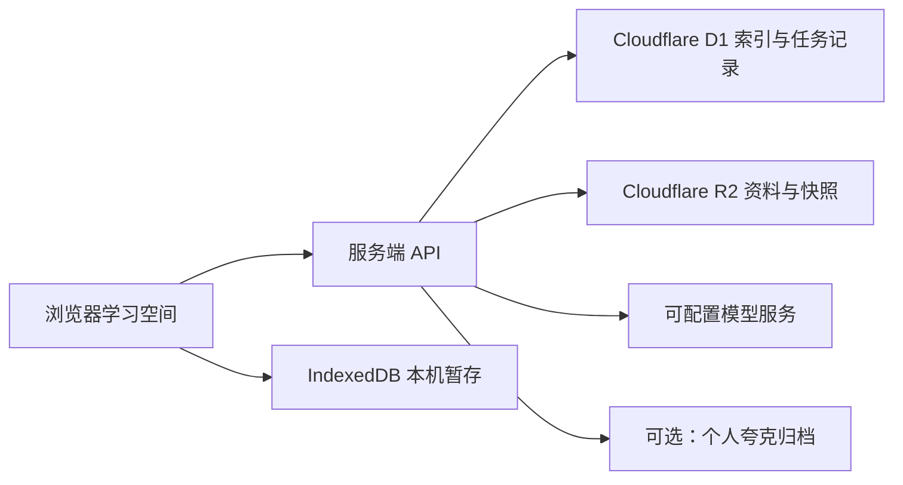

<p align="center"></p>
<h1 align="center">拾知 · Shizhi</h1>
<p align="center">把课程、作业、PDF 和纸上的思考，留在同一个学习空间。</p>

拾知是一个面向个人学习的 AI 工作台。按课程或研究项目组织资料，在阅读课件的同时提问，把作业对话和手写笔记长期保存，并在不同设备间继续学习。

这个项目来自实际使用中的逐步改进：从整理课程入口开始，加入 PDF 分屏、持续文件上下文、笔记管理、跨设备同步和流式公式排版。

## 可以做什么

| 功能 | 说明 |
| --- | --- |
| 课程与项目 | 按学期、课程类型和学习方向分类，支持重命名、搜索和收起课程。 |
| 学习对话 | 上课提问、作业、复习总结分别保留历史，可重命名、搜索和确认删除。 |
| PDF 分屏 | 在对话旁打开 PDF，输入页码跳转、翻页、缩放，同时查看原文与回答。 |
| 持续上下文 | 保存提取的文件文字，支持启用/停用资料和手动保存阶段进度。 |
| 纸质笔记 | 上传照片与扫描 PDF，多选引用、拖动排序、编辑、下载与确认删除。 |
| 方便输入 | Enter 发送、Shift+Enter 换行，支持粘贴图片与附加文档。 |
| 灵活布局 | 收起侧栏和历史列表，拖动调整区域大小，刷新后恢复页面位置。 |
| AI 回答 | 配置服务端模型接口，选择回答深度、停止生成、重试和保留中断内容。 |
| 实时排版 | Markdown、表格和公式边生成边排版，完整公式无需等待整条回复结束。 |
| 跨设备记录 | 本机暂存、按账号隔离、云端课程分区同步、版本比较和历史恢复。 |
| 备份与归档 | 导出/恢复资料，可选接入个人夸克网盘保存原件。 |

## 技术结构



- 界面：HTML / CSS / JavaScript，PDF.js、KaTeX、fflate。
- 服务端：TypeScript、Vinext / Vite、Cloudflare Workers。
- 数据：D1 保存索引、版本和任务状态，R2 保存原件与课程快照。
- 身份：线上依赖 Sites 提供的受信任登录身份，开发环境提供仅限本机的模拟登录。

## 本地运行

需要 Node.js **22.13.0 或更高版本**、npm 和 Git。

```sh
npm ci
```

把 `.dev.vars.example` 复制为 `.dev.vars`。PowerShell：

```powershell
Copy-Item .dev.vars.example .dev.vars
```

macOS / Linux：

```sh
cp .dev.vars.example .dev.vars
```

首次启动前构建并初始化本机数据库：

```sh
npm run build
npm run db:init
npm run dev
```

打开终端打印的本机地址（默认 `http://127.0.0.1:5173`），点击登录进入学习空间。本机模拟账号为 `seedy@sites.test`。数据库初始化可以重复执行，已应用的迁移会跳过。

只整理资料和笔记时可以不填模型密钥。需要模型回答时，在 `.dev.vars` 中填自己的密钥与配置，调用会使用相应服务商账户的额度。

模型 ID、图片能力和接口地址需要与实际服务商保持一致。模板中的模型名称只是配置示例，不代表所有账号都支持。当前接口地址白名单见 `lib/ai-providers.ts`。

## 部署与配置

当前版本使用 **Sites + Cloudflare Workers / D1 / R2**。GitHub 用于保存和展示源码，GitHub Pages 无法运行本项目的服务端功能。

详细步骤见 [部署说明](docs/DEPLOYMENT.md)，变量说明见 [配置说明](docs/CONFIGURATION.md)。

仓库包含空白学习空间和配置模板。课程、笔记、聊天记录、模型密钥、网盘授权和数据库文件都不随源码发布。

## 文件与上下文

- 支持图片、PDF、TXT / Markdown，以及 DOCX / PPTX 的文字提取；旧版 DOC / PPT 需要先转换。
- PDF 文字提取和分屏阅读是不同能力。扫描件可能需要补充页面图片，提取文字也不等于识别了图表布局。
- 当前同一对话启用的文件文字合计最多 **12 万字符**；最近 **20 条消息**使用最多 **3.6 万字符**，更早记录按问题选取片段。
- 大文件和长对话的上下文有范围限制，可在“对话上下文”查看资料并保存阶段进度。
- 笔记删除会移除网站记录与原件引用；**已归档到夸克的副本需要在网盘中手动删除**。

## 检查与开发

```sh
npm run check
npm run build
```

检查包含 TypeScript、脚本语法，以及账号隔离、阶段进度合并、流式取消和部分回答保留等回归用例。测试使用模拟数据，不需要真实模型额度或网盘账号。

```text
app/          服务端页面、登录适配与 API
public/       学习空间、同步、PDF 阅读器与流式排版
lib/          上下文选择、模型接口、存储和夸克归档
drizzle/      数据库迁移
scripts/      开发、构建、检查与本机数据库初始化
tests/        核心回归用例
docs/         部署与配置说明
```

## 当前边界

AI 和夸克归档按空间主人授权使用，生产登录需要可信的服务端身份校验。普通静态托管无法执行完整功能，生产环境也不能信任浏览器自行传入的身份请求头。

模型输入目前会携带启用的文件文字，长文档处理和首次同步仍有优化空间。项目适合个人学习与自部署实验。

## 第三方组件

第三方代码与资源许可见 [THIRD_PARTY_NOTICES.md](THIRD_PARTY_NOTICES.md)。本次发布暂未为原创代码指定开源许可证。
